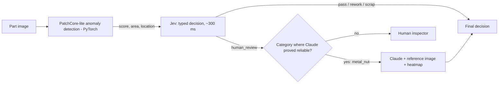
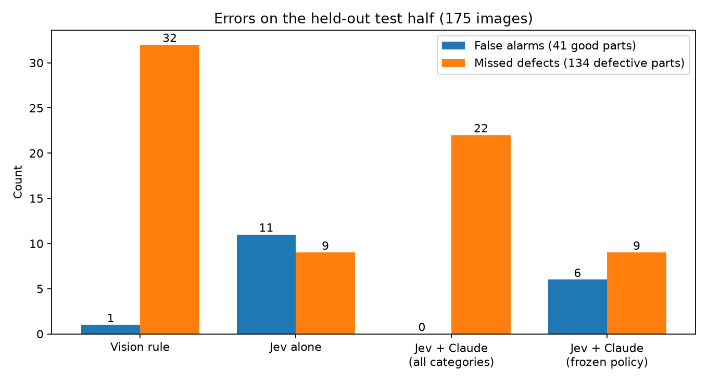
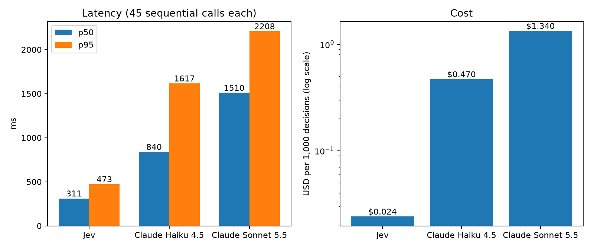
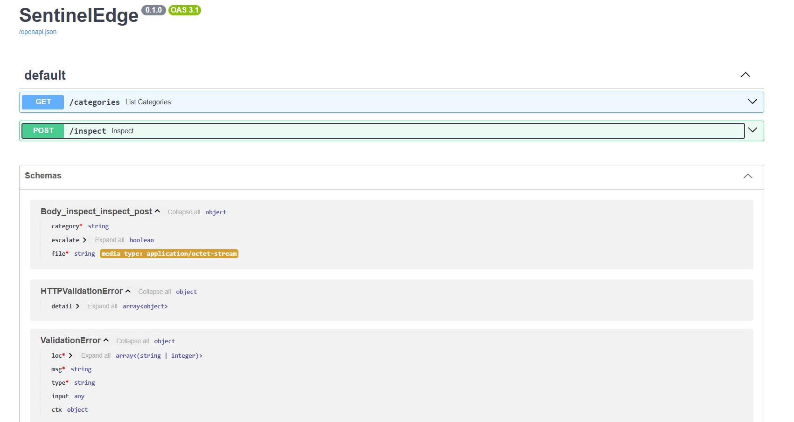

# SentinelEdge: a two-speed AI inspector

An industrial-inspection pipeline that puts **Jev** (TypeSafe's fast "System One" decision model) between a PyTorch vision model and a slower LLM, and tests honestly where each stage helps and where it doesn't.


## How it works



1. **Vision:** a compact PatchCore-style anomaly detector (WideResNet50 features, nearest-neighbour patch distance), trained only on defect-free images.
2. **Jev:** receives the measurements (anomaly score, area, location) as structured state and answers three typed questions in one call: action (choice), severity (score), stop-the-line (boolean).
3. **Escalation:** parts Jev marks `human_review` go to Claude Sonnet 5.5 together with a defect-free reference image, the test image, and the heatmap overlay. This is only allowed for categories where Claude proved reliable on the dev split (frozen policy).

Data: three MVTec AD categories (bottle, metal_nut, screw). Jev and Claude are accessed through Vercel AI Gateway.

## Evaluation protocol

- Stratified 50/50 dev/test split by category and defect type (seed 42). All tuning and diagnosis used the **dev** half only.
- The design was frozen in [`FROZEN.md`](FROZEN.md) (committed in `<commit hash>`, before the test half was run), and the test half was then run once.
- 95% bootstrap confidence intervals (2,000 resamples over images). The test half has 175 images: 41 good, 134 defective.

## Results (held-out test half)



| System | False alarms | Missed defects | Accuracy (95% CI) |
|---|---|---|---|
| Vision rule (score > threshold) | 1 | 32 | 0.811 [0.754, 0.869] |
| Jev alone | 11 | 9 | 0.886 [0.834, 0.931] |
| Jev + Claude, all categories | 0 | 22 | 0.874 [0.829, 0.920] |
| **Jev + Claude, frozen policy** | **6** | **9** | **0.914 [0.869, 0.954]** |

Frozen policy vs Jev alone (paired bootstrap): accuracy +0.029 [0.006, 0.057], false-alarm rate -0.122 [-0.234, -0.029]. Images sent to a human inspector: **86 -> 57**.

### Latency and cost (sequential, persistent connection, from Germany)



| System | p50 | p95 | Cost per 1,000 decisions |
|---|---|---|---|
| Jev | 311 ms | 473 ms | $0.024 |
| Claude Haiku 4.5 | 840 ms | 1,617 ms | $0.47 |
| Claude Sonnet 5.5 | 1,510 ms | 2,208 ms | $1.34 |

Network floor to the gateway: 93 ms median.

## What I found (including what didn't work)

- **Jev is not a better detector than a threshold.** On dev, at the same false-alarm rate (0.333), Jev caught 94.3% of defects and a plain threshold caught 95.0%. Its value here is cheap, fast, typed triage with probabilities.
- **Jev's severity roughly tracks true defect size** (Spearman 0.85 against the ground-truth mask area on dev), but it was statistically level with simply reading the vision stage's area measurement (0.87).
- **Claude resolves ambiguous metal_nut parts perfectly, but fails on screw.** All of its misses were screw defects (accuracy 0.75 on dev, 0.764 on test, so the weakness replicates). Missed defects were small (median 0.24% of the image, vs 0.57% for caught ones). The frozen policy therefore leaves screw with humans.
- **Claude's stated confidence did not separate its right "good" verdicts from its wrong ones** (dev: 0.79 vs 0.75 mean), so it could not be used as an auto-clear threshold.
- **A zoomed crop around the heatmap peak** reduced screw misses only from 15 to 12 on dev. This was below the bar I set beforehand, so it was not adopted.
- **Speed:** Jev's median latency was 2.7x lower than Haiku's and 4.9x lower than Sonnet's, at roughly 20x and 56x lower cost. The advertised 20-200x speedup was not reproduced against short-output LLM calls through a gateway.

## Limitations

- Three categories of one dataset, 175 test images, and a simplified vision model (AUROC: bottle 1.000, metal_nut 0.993, screw 0.857). Confidence intervals are wide.
- The auto-resolve policy was chosen on dev and confirmed once on test. Zero Claude errors on metal_nut is still compatible with a true error rate of several percent.
- The latency comparison covers one location, one run of 45 calls per system, and a text-only prompt for the LLMs. Pass-vs-flag accuracy differences between Jev, Haiku and Sonnet on that run were within noise.
- LLM outputs are not deterministic, so exact Claude numbers can vary between runs.
- MVTec AD is a benchmark, not a production line.

## Reproduce

```bash
pip install -r requirements.txt
cp .env.example .env        # add your Vercel AI Gateway key (paid credit needed for Jev)
```
Download the `bottle`, `metal_nut` and `screw` categories from the [MVTec AD page](https://www.mvtec.com/company/research/datasets/mvtec-ad) into `data/` (not included here, non-commercial license).

```bash
python vision/run_category.py bottle        # also metal_nut, screw
python decision/run_decisions.py            # Jev on all images
python bench/split.py                       # dev/test split
python decision/run_escalation.py           # Claude on dev
python decision/run_escalation.py --test    # Claude on test (run once)
python bench/final_eval.py                  # test metrics + confidence intervals
python bench/latency.py                     # latency and cost
cd app && streamlit run dashboard.py        # demo UI
cd app && uvicorn api:app                   # API (docs at /docs)
```
Dev-only diagnostics: `bench/diagnose.py dev`, `bench/baselines.py`, `bench/diagnose_escalation.py`. Total gateway spend for the whole study: about `<fill in from Vercel usage page>`.



## Future work

- Stronger vision stage (coreset sampling, higher resolution, other backbones) evaluated on a fresh split, since screw errors come from the vision limit.
- More categories, and comparison with other decision-model providers on the gateway.
- Per-defect-type analysis and cost-weighted evaluation (a shipped defect usually costs more than a false alarm).

## Credits and licenses

Code: MIT. Data: MVTec AD (Bergmann et al.), CC BY-NC-SA 4.0, non-commercial use only. Method inspired by PatchCore (Roth et al., CVPR 2022). Jev by TypeSafe; Claude by Anthropic; both via Vercel AI Gateway.